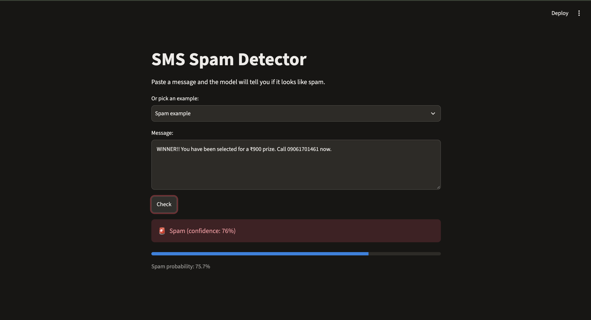
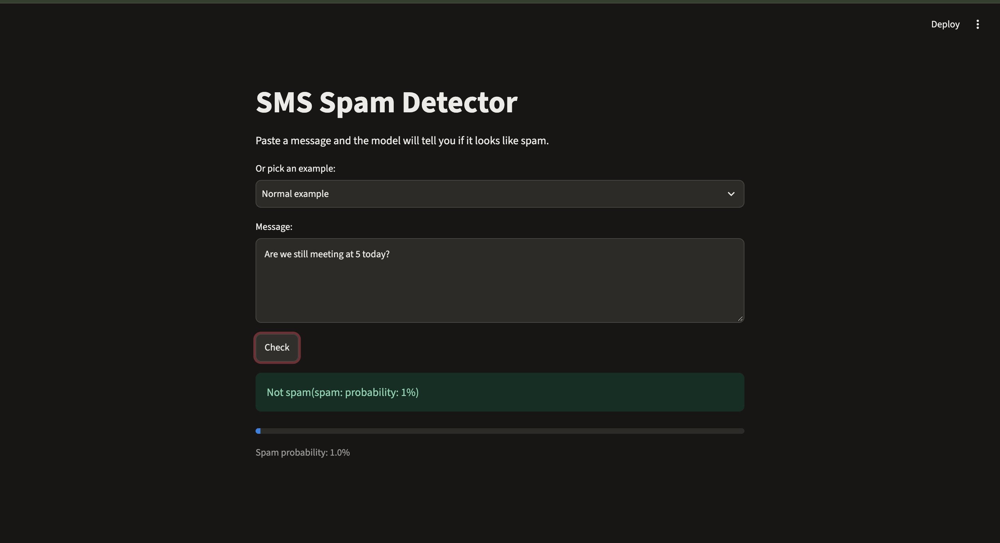
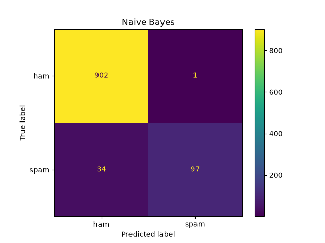

# 📩 SMS Spam Classifier

A machine learning project that detects whether a text message is **spam** or **not spam (ham)**. It uses TF-IDF to turn text into numbers, compares two classic models (Naive Bayes and Logistic Regression), and serves the best one through a simple web app built with Streamlit.





---

## ✨ Features

- Cleans the dataset and removes duplicate messages
- Trains and compares **Naive Bayes** and **Logistic Regression**
- Chooses the best model automatically using the spam F1-score
- Saves the full pipeline (TF-IDF + model) so the app accepts raw text
- Web app with a text box, example messages, a spam / not-spam verdict and a probability bar
- Saves a confusion matrix image for the best model

---

## 🧠 How it works

```
Raw message ──► TF-IDF vectorizer ──► Classifier ──► Spam / Not spam
                (text → numbers)      (Naive Bayes or
                                       Logistic Regression)
```

1. **Load and clean:** read the CSV, rename columns, map `ham → 0` and `spam → 1`, drop duplicate rows.
2. **Split:** 80% of messages for training and 20% for testing, using a stratified split so both sets keep the same spam share.
3. **Vectorize:** `TfidfVectorizer` lowercases the text, removes English stop words, and scores each word by how distinctive it is.
4. **Train and compare:** both models are trained inside a scikit-learn `Pipeline` and evaluated on the unseen test set.
5. **Save the best:** the pipeline with the higher spam F1-score is saved with `joblib`.
6. **Serve:** `app.py` loads the saved pipeline and predicts on whatever the user types.

---

## 📊 Dataset

- **SMS Spam Collection** (UCI Machine Learning Repository, also available on Kaggle)
- About 5,570 labelled messages, around 5,170 unique after removing duplicates
- Roughly **13% spam**, so the classes are imbalanced. For this reason, accuracy alone is not a good measure, and precision, recall and F1 are reported for the spam class.

Place the file at `data/spam.csv` (columns `v1` = label, `v2` = message).

---

## 📈 Results

Evaluated on 1,034 held-out test messages (903 ham, 131 spam):

|         Model              | Accuracy | Spam precision | Spam recall | Spam F1 |
|----------------------------|----------|----------------|-------------|---------|
| **Naive Bayes** (selected) |   0.97   |       0.99     |    0.74     |   0.85  |
|   Logistic Regression      |   0.96   |       0.99     |    0.68     |   0.81  |

**Confusion matrix (Naive Bayes):**

|                 | Predicted ham | Predicted spam |
|-----------------|---------------|----------------|
| **Actual ham**  |      902      |      1         |
| **Actual spam** |      34       |      97        |



**What this means:**

- The model is **cautious**: only 1 of 903 normal messages was wrongly flagged as spam, so real messages are rarely blocked.
- About **26% of spam (34 of 131)** gets through, usually messages written in a friendly, conversational tone with few typical spam words.
- Results come from a single train/test split, so small differences between models (such as 0.85 vs 0.81) should not be over-interpreted.

---

## 🗂️ Project structure

```
spam-classifier/
├── data/
│   └── spam.csv              # dataset
├── model/
│   └── spam_model.joblib     # saved pipeline (created by train.py)
├── screenshots/              # images used in this README
├── explore.py                # quick look at the data
├── train.py                  # trains, compares and saves the model
├── app.py                    # Streamlit web app
├── confusion_matrix.png      # created by train.py
├── requirements.txt
└── README.md
```

---

## 🚀 Run it yourself

**1. Clone the repository**

```bash
git clone https://github.com/Tridev978/spam-classifier.git
cd spam-classifier
```

**2. Create a virtual environment (recommended)**

```bash
python3 -m venv venv
source venv/bin/activate
```

**3. Install the dependencies**

```bash
pip install -r requirements.txt
```

**4. Start the app**

```bash
streamlit run app.py
```

The app opens in your browser at `http://localhost:8501`.

> The saved model was trained with the scikit-learn version listed in `requirements.txt`. If you use a different version, re-run `python train.py` to avoid loading problems.

---

## 🧪 Try these messages

|                         Message                                             | Expected  |
|-----------------------------------------------------------------------------|-----------|
| `WINNER!! You have been selected for a £900 prize. Call 09061701461 now.`   |   Spam    |
| `Free entry in 2 a weekly comp to win FA Cup final tkts. Text FA to 87121.` |   Spam    |
|                      `Are we still meeting at 5 today?`                     | Not spam  |
|           `Ok, I'll reach home by 8 and call you after dinner.`             | Not spam  |

---

## ⚠️ Limitations

- Trained on older, mostly UK-style SMS data, so modern phishing and scam messages may be missed.
- TF-IDF treats text as a bag of words and ignores word order and meaning.
- Spam recall is 0.74, so some spam will get through.
- Only English messages are supported.
- Evaluated on a single train/test split with no cross-validation.

---

## 🔮 Future improvements

- [ ] Tune Logistic Regression (`C`, `class_weight="balanced"`) and compare using cross-validation
- [ ] Add word n-grams (`ngram_range=(1, 2)`) to capture phrases like "free entry"
- [ ] Show the top words that pushed a message towards spam
- [ ] Try a transformer-based model (for example a pretrained Hugging Face model)
- [ ] Deploy the app online with Streamlit Community Cloud

---

## 🛠️ Built with

Python · pandas · scikit-learn · matplotlib · joblib · Streamlit

---

## 🙏 Acknowledgements

- Dataset: Almeida, T.A., Gómez Hidalgo, J.M., Yamakami, A. — *SMS Spam Collection* (UCI Machine Learning Repository)

---

## 👤 Author

**Tridev Badari R**  
CSE (AI), Amrita Vishwa Vidyapeetham, Chennai  
GitHub: https://github.com/Tridev978